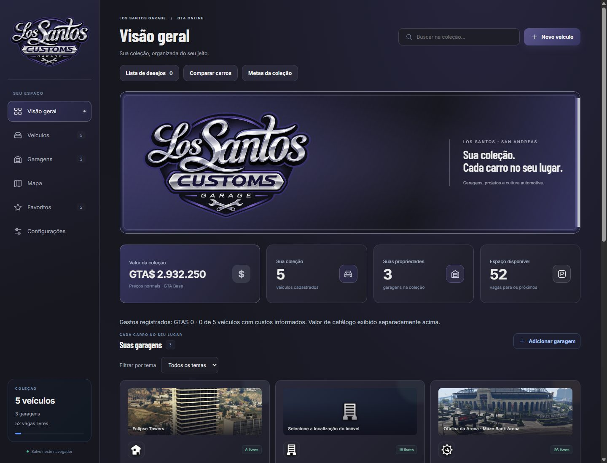
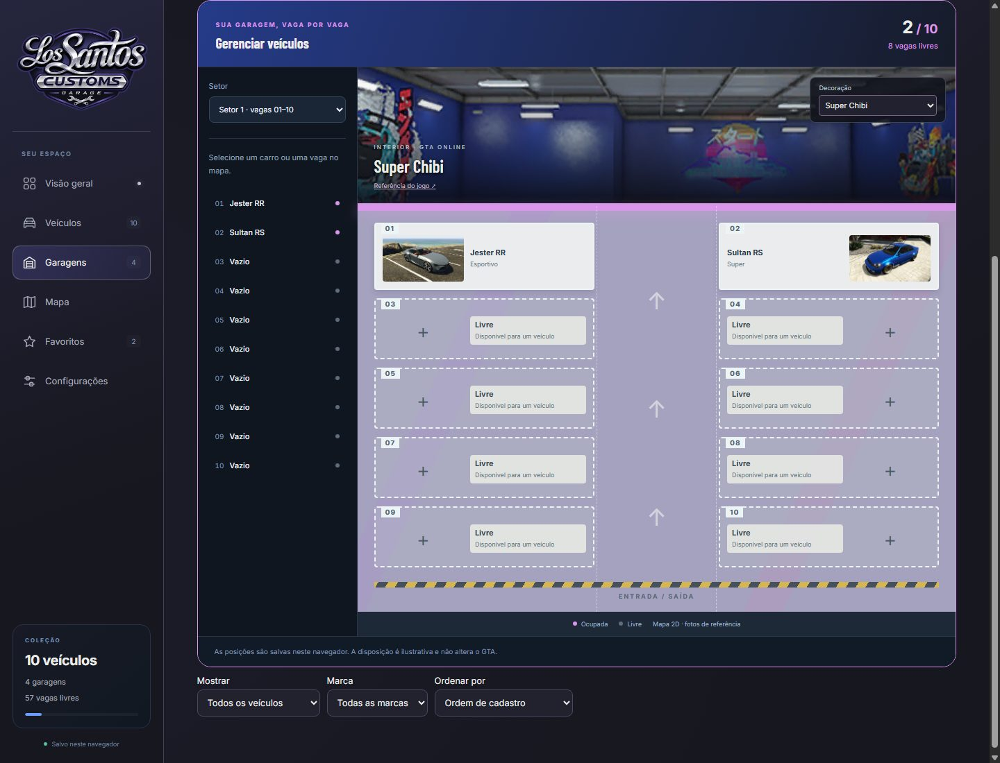
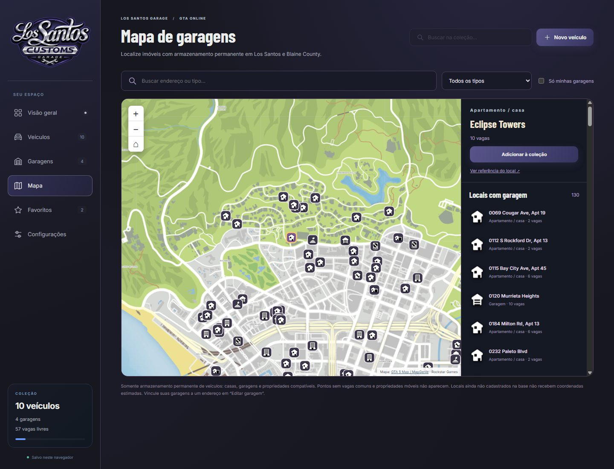
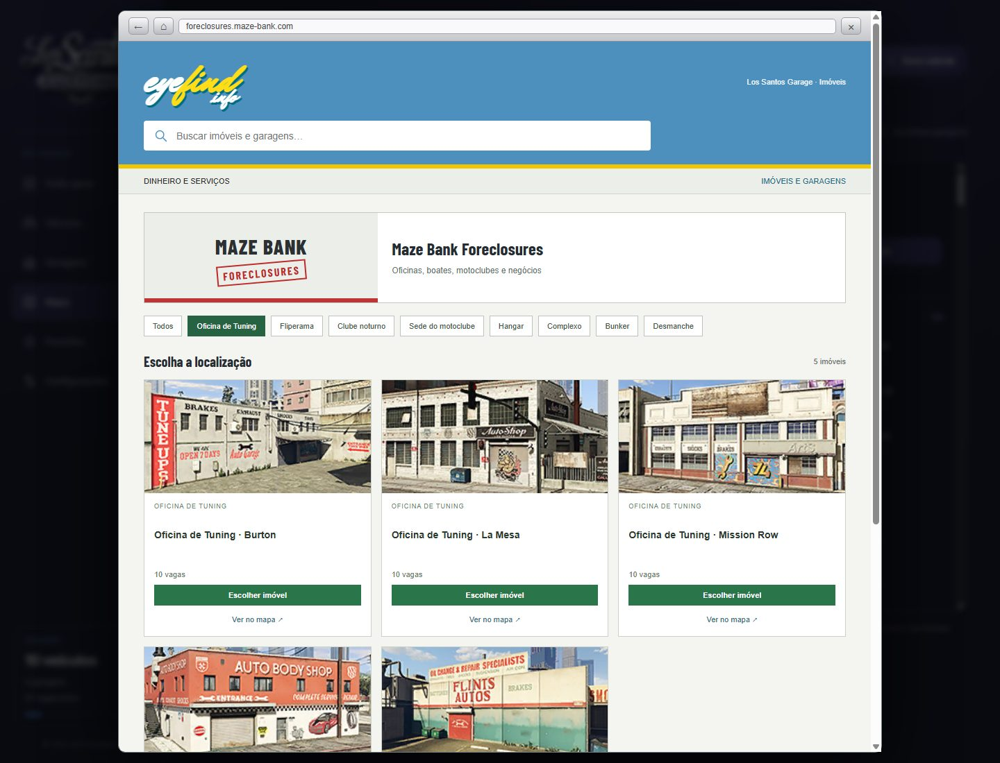
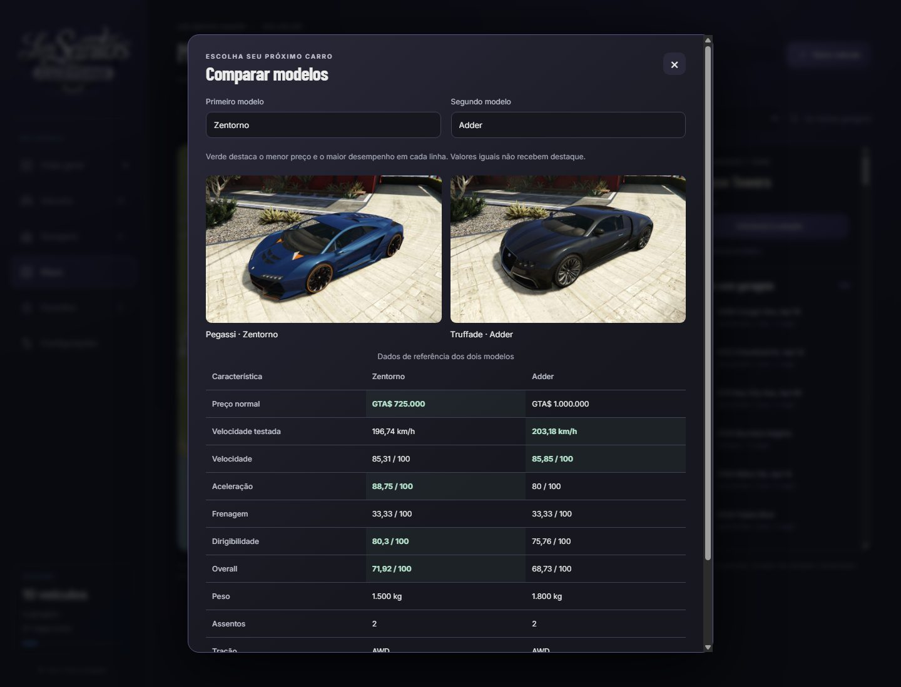
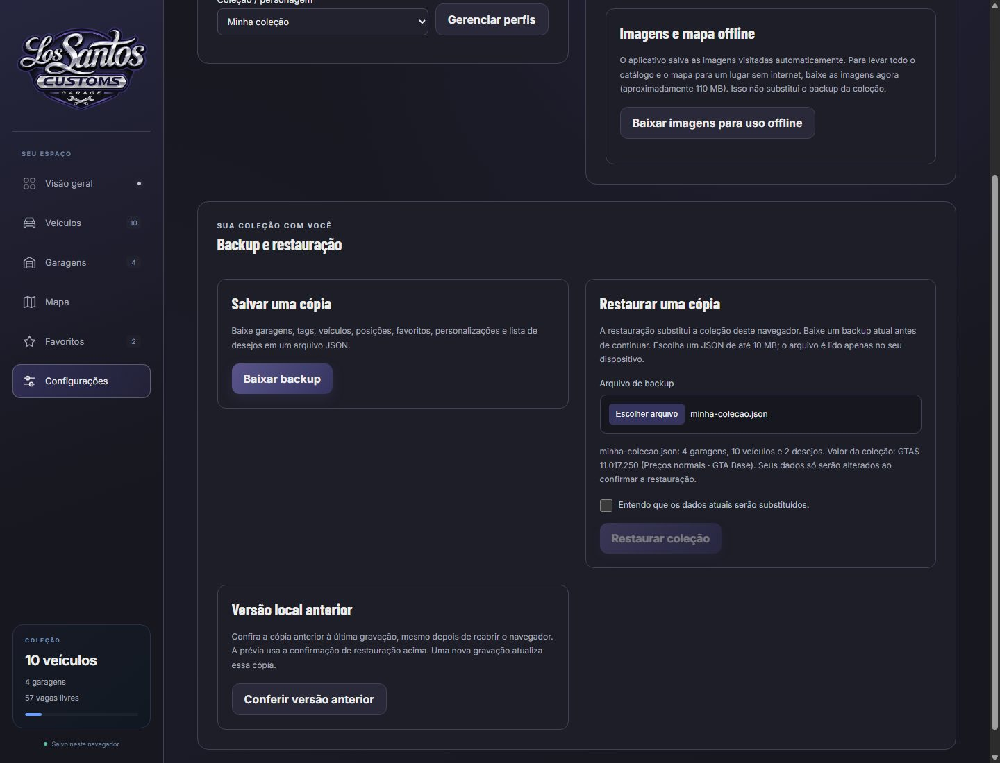
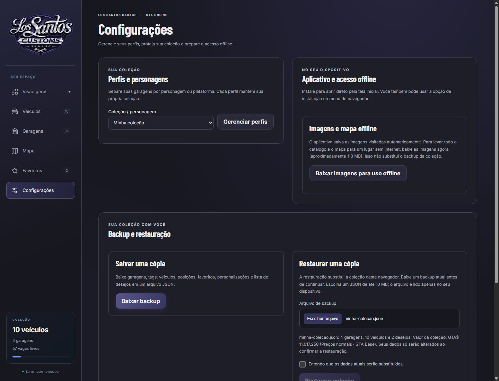

# Los Santos Garage

Organize sua coleção do GTA Online: encontre seus carros, acompanhe o valor
de cada garagem e escolha propriedades pelo mapa de Los Santos.

**[Abrir o site](https://p3dr0ns.github.io/los-santos-garage/)** ·
[Garagens](GARAGENS.md) · [Catálogo de carros](CATALOGO.md) · [Mapa](MAPA.md)

> As capturas usam uma coleção de demonstração criada somente para a documentação.
> O primeiro acesso ao site começa vazio, sem carros ou garagens cadastrados.

Identidade visual inspirada nas oficinas de Los Santos, com letreiro cromado,
azul índigo, grafite e prata cromado e referências dos interiores reais do jogo por tipo de
propriedade. Na **Oficina de Tuning**, escolha entre os nove estilos Undressed,
Flawless, Polished, Concrete Chic, Nostalgia Trip, Route 68, Super Chibi,
Wildstyle e Race and Chase. A decoração é salva por garagem e altera a foto
de referência, as cores e o piso do mapa. Pode ser escolhida no cadastro/edição
ou diretamente na vista de vagas. Referências em `assets/interior-images.js`.

A paleta usa grafite `#17171F`, índigo `#35345F`, prata `#BFC3CE`, branco gelo
`#ECEDEB` e roxo azulado `#59558B`. Letras com degradê metálico e destaques
discretos remetem às oficinas californianas da Los Santos Customs.
A logo fornecida é usada no menu lateral e no destaque da página inicial,
preservando a imagem original em `assets/logo-los-santos-customs.png`.

Abra `index.html` no navegador ou acesse o site publicado. Os cadastros ficam no
`localStorage` do navegador. O arquivo local e o site possuem armazenamento separado.
O primeiro acesso começa vazio, sem garagens ou veículos de demonstração.
Cadastros já salvos são preservados nas atualizações.

## Recursos

- **Configurações:** abra pelo menu lateral ou pela navegação inferior no celular.
  A página reúne perfis, instalação do aplicativo, imagens offline, backup e recuperação.
  Os lembretes de backup ficam nessa página; a coleção mantém os atalhos de desejos,
  comparação e metas. O botão **Desfazer** fica junto aos controles dos veículos.
- **Perfis por personagem/plataforma:** selecione a coleção ativa ou crie e renomeie
  perfis independentes. Os dados existentes ficam em **Minha coleção**, sem migração
  destrutiva. Cada backup JSON contém apenas o perfil ativo.
- **Filtros e ordenação:** filtre por marca, veículos sem garagem, modelos repetidos
  ou projetos de tuning. Ordene por nome, marca, preço de catálogo ou gasto registrado.
  A busca da coleção aceita palavras sem acento.
- **Desfazer e recuperação:** desfaça até 20 alterações na sessão atual, incluindo
  exclusões e transferências. A versão anterior à última gravação também fica salva
  localmente para recuperação após reabrir. Dados danificados não são substituídos
  silenciosamente. Alterações de outra aba bloqueiam a gravação até resolver o aviso.
- **Compra e tuning:** abra a ficha do veículo para informar o preço pago, gastos
  anteriores e tarefas de modificação com orçamento e conclusão. O gasto real soma
  compra, gastos anteriores e tarefas concluídas; o orçamento pendente aparece à parte.
  O valor de catálogo mantém sua definição original. Custos não informados são
  sinalizados e não representam o valor completo da coleção.
- **Metas:** acompanhe marcas, categorias ou ocupação de garagens, com quantidade
  personalizada opcional. Metas de marcas/categorias contam modelos distintos do
  catálogo; veículos repetidos não aumentam o progresso.
- **Compartilhar garagem:** baixe uma imagem PNG com nome, tema e veículos da garagem.
  O compartilhamento direto aparece quando suportado pelo dispositivo. Ao abrir o
  HTML como arquivo local, a imagem é gerada sem fotos por restrição do navegador.
- **Aplicativo e offline:** no site publicado, instale pelo botão oferecido pelo
  navegador ou pelo menu do dispositivo. Após a primeira carga completa, a interface
  funciona sem internet e mantém os cadastros locais. Imagens visitadas são guardadas;
  em **Configurações → Aplicativo e acesso offline**, baixe também todas as imagens
  e o mapa para uso offline.
  Fontes externas usam as alternativas locais quando indisponíveis. Atualizações do
  aplicativo são ativadas depois de fechar as abas da versão anterior.
- **Lembrete de backup:** coleções com veículos recebem um lembrete quando não houve
  exportação nos últimos sete dias. Histórico e cache também podem ser apagados pelo
  navegador; exporte o JSON de cada perfil para manter cópias independentes.
- **Transferência em lote:** selecione carros de uma ou várias garagens e confirme
  o destino. Vagas e restrições de propriedades são conferidas antes de salvar;
  cada carro mantém favoritos, rodas, pintura e observações.
- **Lista de desejos:** escolha modelos do catálogo e acompanhe quanto falta
  comprar. Modelos já presentes na coleção não entram no orçamento. Use
  **Cadastrar compra** para preencher o cadastro de uma nova aquisição.
- **Filtros por tema:** encontre garagens pelas tags JDM, drift, clássicos ou
  qualquer tema criado por você. O filtro também oferece **Sem tema**.
- **Comparar carros:** escolha dois modelos para ver preço, velocidade testada,
  aceleração, frenagem e dirigibilidade lado a lado. Dados ausentes são indicados.
- **Backup e restauração:** baixe sua coleção em JSON e restaure em outro
  navegador. Inclui garagens, temas, veículos, posições, favoritos, personalizações
  e desejos. A importação valida o arquivo e exige confirmação antes de substituir
  a coleção atual; tudo é processado localmente, sem envio de dados.
- Cadastro e edição de veículos, favoritos e busca por modelo, marca e categoria.
- Catálogo de 618 modelos/variantes e 54 marcas; veja [CATALOGO.md](CATALOGO.md).
- Imagem automática do GTA Base nos cartões, cadastro e ficha. As imagens ficam
  locais para uso offline. Fotos pessoais e URLs antigas não são utilizadas.
- Ficha com preços, desempenho, inspiração real e especificações técnicas;
  veja [GTABASE.md](GTABASE.md).
- Valor total da coleção e dos veículos de cada garagem, pelo preço normal do
  catálogo GTA Base. Inclui carros repetidos e veículos sem garagem no total
  geral. Não inclui modificações ou descontos. Preços ausentes são sinalizados
  como total parcial; não são tratados como veículos gratuitos.
- Registro textual de pintura, rodas, placa e observações. Não há editor visual,
  upload de fotos, captura de prints ou galeria pessoal.
- Catálogo de rodas por tipo e modelo; veja [RODAS.md](RODAS.md).
- Cadastro, edição e remoção de garagens e tags de tema. Cada unidade do Eclipse
  Towers tem 10 vagas, sem exigir número do apartamento. Use o nome da garagem
  para diferenciar as unidades, se quiser.
- Ao abrir uma garagem, aparecem apenas os veículos guardados nela.
- Cards das garagens e imóveis do Eyefind mostram a fachada de cada endereço,
  com fotos locais do GTA Wiki. O interior e a decoração ficam na vista de vagas.
  Cadastros antigos reconhecem nomes como Eclipse Towers; nomes personalizados
  usam a localização vinculada. Sem endereço identificado, o card convida a selecioná-lo.
- Mapa do GTA no menu, apenas com locais de armazenamento permanente, zoom,
  busca e filtro das garagens vinculadas. **Adicionar garagem** abre um Eyefind
  com os sites de imóveis; escolher um local preenche o cadastro e o endereço.
  Veja [MAPA.md](MAPA.md) para a cobertura e as fontes.
- Vista 2D com vagas numeradas, fotos de referência e posições salvas por veículo.
  Selecione um carro e use **Trocar posição**; escolher uma vaga ocupada troca os
  dois carros. Garagens maiores são divididas em setores de até 10 vagas.
  Vagas livres permitem cadastrar um veículo diretamente naquela posição.
  A opção **Lista** mantém a visualização em cartões. O mapa é ilustrativo,
  sem reprodução 3D do interior do GTA e sem alterar a organização dentro do jogo.
- Remover uma garagem mantém seus veículos como **Sem garagem**, para realocação posterior.
- Layout responsivo para computador e celular.

## Conheça o site

### Cada carro no seu lugar

Abra uma garagem para ver apenas os veículos guardados nela. As vagas têm
posições salvas, e as oficinas permitem escolher entre nove estilos de decoração.

### Suas propriedades no mapa

Encontre locais com armazenamento permanente, filtre por tipo de propriedade
e veja quais imóveis já fazem parte da sua coleção.

### Escolha um imóvel pelo Eyefind

Cadastre garagens pelos sites inspirados no jogo. Cada endereço tem sua própria
fachada; ao escolher um imóvel, o formulário já recebe o local e a capacidade.

### Planeje a coleção e compare antes de comprar

A barra de ferramentas abre a lista de desejos e a comparação dos modelos.
Veja também as telas de [lista de desejos](docs/images/desejos.jpg) e
[transferência em lote](docs/images/transferencia.jpg).

### Leve sua coleção para outro navegador

Em **Configurações → Backup e restauração**, baixe o JSON da coleção ou escolha um arquivo
para conferir o resumo. A restauração substitui os dados atuais após confirmação.

## Fontes das imagens

As imagens são obtidas das páginas individuais do
[catálogo do GTA Base](https://www.gtabase.com/grand-theft-auto-v/vehicles/).
`assets/vehicle-images.js` registra a origem e o caminho de cada imagem.
Variantes Drift sem ficha específica compartilham a imagem do modelo base, com
essa identificação na ficha. Modelos personalizados sem correspondência no
catálogo exibem uma ilustração padrão, sem solicitar imagem ao usuário.

`scripts/update-vehicle-images.ps1` usa os metadados das páginas em cache ou
as URLs já registradas no catálogo. `-Offline` reconstrói o índice usando os
arquivos locais, sem depender dos HTMLs de consulta. Imagens idênticas
compartilham um único arquivo. Novas imagens são baixadas com concorrência
limitada e interrupção ao receber 403 ou 429.

As fachadas dos 141 endereços e os interiores vêm do [GTA Wiki](https://gta.wiki/).
As origens estão em `assets/property-images.js` e `assets/interior-images.js`.
Imagens e marcas do GTA pertencem aos seus respectivos titulares. Este projeto
é uma ferramenta de fãs, sem vínculo com a Rockstar Games.

## Validação e publicação

Execute `tests/run-checks.ps1` para validar catálogos, navegação, cadastros,
garagens, mapa, Eyefind e falhas de armazenamento no Chrome em 360, 900 e
1440 pixels. `scripts/prepare-deploy.ps1` prepara `dist/` apenas com arquivos
usados pelo site, sem documentação e metadados de manutenção das imagens.
`tests/run-checks.ps1 -SiteRoot ./dist` valida esse pacote no navegador;
`tests/project-check.ps1 -SiteRoot ./dist -Published` também verifica os
recursos publicados e é executado pelo workflow antes do deploy.

A suíte também valida os novos perfis, filtros, desfazer, recuperação, conflitos,
custos, tuning e metas. `tests/pwa-check.ps1` abre um servidor HTTP descartável para
verificar instalação, exportação de PNG com fotos e recarga sem internet no mesmo
subdiretório do GitHub Pages. O workflow executa a suíte completa no Windows antes
de liberar a publicação; uma falha bloqueia o deploy.

Cada alteração deve ser publicada. O push em `main` aciona
`.github/workflows/pages.yml`, que publica `dist/` no GitHub Pages.

Para atualizar as capturas do README, execute `./tests/run-checks.ps1 -Documentation`.
Elas são geradas pelo Chrome em `docs/images/`, com dados de teste em um perfil
descartável. Os arquivos de documentação não entram no pacote publicado do site.
